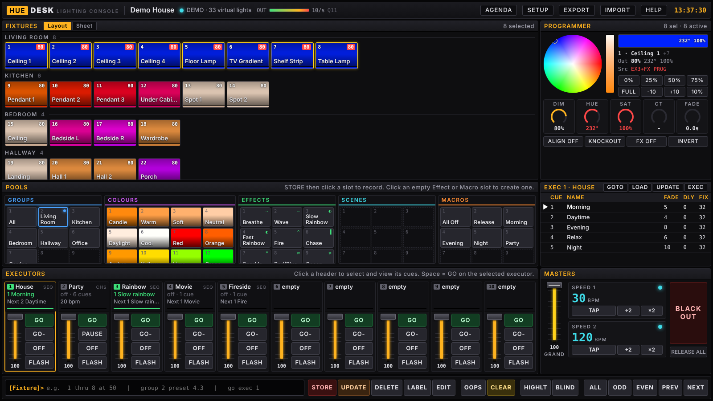
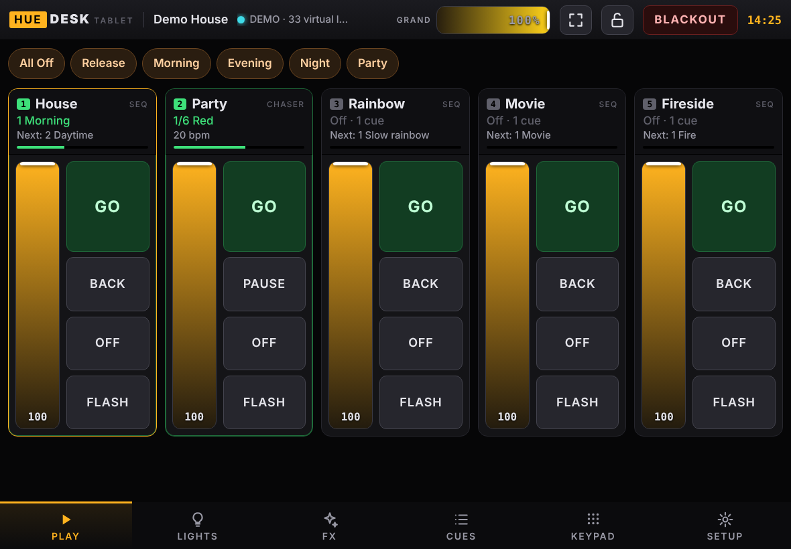

# HueDesk

A lighting console for Philips Hue, built to look and work like a professional theatre desk. It runs as a single HTML file in your browser and talks directly to your Hue Bridge on your home network. There is no server, no account and no cloud.

There are two versions, sharing the same engine and show file format:

| File | For |
|---|---|
| `huedesk.html` | Desktop and laptop: the full desk with keyboard, mouse and command line |
| `HueDesk_Tablet.html` | Tablets: touch-first, made to carry round the house or run as a wall-mounted kiosk. See [HueDesk_Tablet](#huedesk_tablet). |



---

## Contents

1. [What you get](#what-you-get)
2. [Requirements](#requirements)
3. [Getting started](#getting-started)
4. [Core ideas](#core-ideas)
5. [The screen, area by area](#the-screen-area-by-area)
6. [Common tasks](#common-tasks)
7. [Command line reference](#command-line-reference)
8. [Keyboard shortcuts](#keyboard-shortcuts)
9. [Effects reference](#effects-reference)
10. [Executor settings](#executor-settings)
11. [Smart plugs and on/off devices](#smart-plugs-and-onoff-devices)
12. [How output to Hue works](#how-output-to-hue-works)
13. [Show files and saving](#show-files-and-saving)
14. [Demo mode and the guided tour](#demo-mode-and-the-guided-tour)
15. [HueDesk_Tablet](#huedesk_tablet)
16. [Troubleshooting](#troubleshooting)
17. [Limitations](#limitations)
18. [Licence](#licence)

---

## What you get

- **Fixtures** for every Hue light and plug, numbered and grouped by room, with a live colour/intensity view and a second strip showing what the bulb itself is doing.
- **A programmer** with colour wheel, colour temperature bar, DIM / HUE / SAT / CT / FADE encoders, Align (fanning), Highlight, Blind, Knockout and Oops (undo).
- **Pools** for Groups, Colour presets, Effects, Scenes and Macros.
- **10 executors**, each holding a cue list. Run them as tracking **sequences** (GO / GO- with per-cue fade and delay) or as **chasers** (auto-stepping at a BPM with crossfade).
- **An effects engine**: sine, ramp, chase, sparkle, fire flicker, rainbow and two-colour, with phase spread, blocks, wings and speed-master linking.
- **Masters**: Grand Master, two Speed Masters with tap tempo, Blackout and Release All.
- **A desk-style command line** (`1 thru 8 at 50`, `store cue 4 exec 2`, `goto cue 3 exec 1` and more).
- **Agenda** for time-of-day automation.
- **Show files** that save automatically and can be exported and imported.
- **Demo mode** with virtual lights, and a guided tour of the interface.

---

## Requirements

- A **Philips Hue Bridge** (the square v2 bridge or the newer Bridge Pro) on the same network as your computer.
- A desktop browser: **Chrome, Edge or another Chromium browser** is recommended. Firefox and Safari should work but are less tested.
- A screen at least **1240 x 780** pixels. The desk is designed for desktop and laptop use.

---

## Getting started

### 1. Open the desk

You can simply double-click `huedesk.html`. However, some browsers block a page opened from a file from talking to devices on your network. If the bridge will not connect, **serve the folder from your own machine** instead and open it through `localhost`. Any one of these works, run from the folder containing `huedesk.html`:

```bash
npx serve .                    # Node.js
python -m http.server 8080     # Python 3
dotnet serve -p 8080           # .NET (dotnet tool install -g dotnet-serve)
```

Then open `http://localhost:8080/huedesk.html` (use the port each tool prints).

> Your show is saved per browser *and* per address. A show built while opened as a file will not appear when you open the same page through `localhost`, and vice versa. Pick one way of opening it and stick to it, or move your show across with Export and Import.

If your browser asks for permission to **access devices on your local network**, allow it. That is how it reaches the bridge.

### 2. Connect to your bridge

HueDesk needs two things: your bridge's **IP address** and an **app key** (the bridge calls it a *username*). The key is how the bridge knows HueDesk is allowed to control your lights. You create it once by pressing the link button on the bridge.

> **Why there is a certificate step.** Hue bridge firmware released since mid-2025, and every Hue Bridge Pro, only accepts secure (HTTPS) connections. The bridge uses its own security certificate, which browsers do not recognise. So each browser has to be told to trust it once, or it will silently refuse to talk to the bridge. HueDesk tries a secure connection first and falls back to plain HTTP for older bridges.

On first launch you will see a welcome screen. Choose **Connect my Hue Bridge** (or open **Setup** from the top bar at any time).

1. **Bridge IP**: click **Discover** to look it up, or find it in the Hue app under *Settings > My Hue system > Bridge* (or in your router's list of connected devices).
2. **Trust certificate**: click **Trust certificate**. A new tab opens on the bridge and shows a security warning. Choose **Advanced**, then **Proceed** (Chrome and Edge), **Accept the Risk and Continue** (Firefox) or **Visit this website** (Safari). You should then see a few lines of text about your bridge. Close that tab and return to HueDesk.
3. **Get an app key**, using whichever method below works for you.
4. **Connect**: click **Connect**. HueDesk reads your lights, rooms and zones, numbers the lights room by room, and creates a group for each room. The status light in the top bar turns green.

You only do steps 2 and 3 once per browser. If you later use HueDesk in a different browser or on a tablet, repeat step 2 there and reuse the same key.

#### Getting an app key

**Method A: Pair button (easiest)**

1. Click **Pair** in Setup. HueDesk first checks it can reach the bridge, then says *Press the round link button*.
2. Press the link button on top of the bridge within 30 seconds.
3. The key fills in automatically. Click **Connect**.

If Pair says it could not talk to the bridge, do the **Trust certificate** step and try again. If it still fails, use method B.

**Method B: the bridge's built-in debugger**

Every Hue bridge has a small test page for developers, which you can use to create a key by hand.

1. In your browser, go to `https://<bridge-ip>/debug/clip.html` (for example `https://192.168.1.20/debug/clip.html`). Accept the security warning as described above.
2. In the **URL** box, enter `/api`.
3. In the **Message Body** box, enter:
   ```json
   {"devicetype":"huedesk#browser"}
   ```
4. Press the round **link button** on top of the bridge.
5. Within 30 seconds, click **POST**.
6. The **Command Response** box shows something like:
   ```json
   [{"success":{"username":"1a2B3c4D5e6F7g8H9i0JkLmNoPqRsTuVwXyZ1234"}}]
   ```
   If it says `link button not pressed`, press the button again and click POST within 30 seconds.
7. Copy the long string after `"username":` and paste it into **App key** in HueDesk's Setup. You can paste the whole response if that is easier; HueDesk picks out the key. Click **Connect**.

Doing this in the same browser you use for HueDesk also takes care of the Trust certificate step.

**Method C: from a command line (if the debugger page will not load)**

If the debugger page will not load, you can make the same request from a terminal on any computer on your network. Press the bridge's link button first, then run the command within 30 seconds, replacing `192.168.1.20` with your bridge's IP.

macOS or Linux (Terminal):
```bash
curl -k -X POST https://192.168.1.20/api -d '{"devicetype":"huedesk#pc"}'
```

Windows (Command Prompt, Windows 10 or later):
```bat
curl -k -X POST https://192.168.1.20/api -d "{\"devicetype\":\"huedesk#pc\"}"
```

Windows (PowerShell 7):
```powershell
Invoke-RestMethod -Method Post -Uri https://192.168.1.20/api -Body '{"devicetype":"huedesk#pc"}' -SkipCertificateCheck
```

`-k` and `-SkipCertificateCheck` accept the bridge's own certificate for that one request. The reply is the same `[{"success":{"username":"..."}}]` as above; paste the key into HueDesk and click **Connect**. On an older bridge that does not answer on `https://`, use `http://` instead (and leave out `-k`).

> **Keep your key private.** Anyone on your home network with the key can control your lights. HueDesk stores it only in your browser, and **Export never includes it**, so shared show files are safe to publish. Treat it like a password and keep it out of screenshots and public files.

**Opening the desk does not change your lights.** Nothing is sent until you set a value, run an effect or press GO.

### 3. Take the tour

The first time you connect to a real bridge, a guided tour walks you round the screen. You can replay it any time from **Help > Start guided tour**.

### 4. Optional: build starter cues

**Setup > Rebuild starter cues** fills executors 1 to 5 with a ready-made show based on your rooms:

| Executor | Name | Contents |
|---|---|---|
| 1 | House | Sequence: Morning, Daytime, Evening, Relax, Night |
| 2 | Party | Chaser: Red, Magenta, Blue, Cyan, Green, Amber on all colour lights |
| 3 | Rainbow | A slow rainbow across all colour lights |
| 4 | Movie | Everything off except a low blue glow in the living room |
| 5 | Fireside | Fire flicker on the living room colour lights |

Starter cues never include plugs. This replaces whatever is on executors 1 to 5, so only use it on a fresh show.

---

## Core ideas

If you have used a theatre desk, these will be familiar. If not, these are the few things worth understanding.

### Fixtures and selection
Each light is a **fixture** with a number. You **select** fixtures, then change them. The selection has an **order** (the order you clicked them), which matters for Align and effect phase.

### The programmer
The **programmer** is a scratch pad. Any value you set with the wheel, encoders, presets or command line goes into the programmer and straight to the lights. **The programmer always wins** over everything else. Values in the programmer show in **red**.

You **store** the programmer's contents into cues, groups, presets and scenes. When you are finished, **CLEAR** the programmer.

### Cues and tracking
A **cue** is a stored look with a fade time. Cues live in **executors**. Sequences **track**: a light keeps the value it was given in an earlier cue until a later cue changes it. So cue 2 only needs to hold what changes from cue 1.

### How sources combine
Several things can control the same light at once. HueDesk combines them like a professional desk:

1. **Executors**: intensity is **highest takes precedence** (HTP); the brightest executor wins. Colour is **latest takes precedence** (LTP); the executor you most recently pressed GO on wins.
2. **Executor effects** are applied on top.
3. **Programmer** values override everything above.
4. **Programmer effects** override programmer values.
5. **Highlight** forces selected lights to full white.
6. **Grand Master** scales all intensity. **Blackout** forces everything off.

### Release
When nothing controls a light (no programmer value, no running executor), the desk **stops sending to it** and the light simply **stays as it is**. It does not snap off. This makes the desk safe to use alongside the Hue app, switches and other automations. If you want lights to go off, set them to 0 or use an executor's OFF button, which fades them down.

---

## The screen, area by area

### Top bar

| Item | Purpose |
|---|---|
| Show name | Click to rename the show. |
| Status light | Green connected, cyan demo, amber connecting, red error. |
| **OUT** meter | Commands per second being sent to the bridge. |
| **Q** | Lights currently waiting for an update. If it stays high, you are asking for more change than Hue can deliver. |
| Agenda | Time-of-day automation. |
| Setup | Bridge pairing, output rate, show settings, patch list. |
| Export / Import | Save or load the show as a `.json` file. |
| Help | Command reference and the guided tour. |

### Fixtures window

- **Layout** view shows tiles grouped by room. **Sheet** view shows a table with dimmer, colour, source and lamp state.
- **Click** a tile to toggle selection. **Shift-click** selects a range. **Click a room heading** to select the room; Shift-click a heading to add it.
- Tile top-left: fixture number. Top-right: intensity, or **ON / OFF** for plugs. A red badge means the light has a programmer value. **FX** means a programmer effect is running.
- The tile colour is what the desk is sending. The **thin bottom strip** shows what the bulb is actually doing (it lags slightly behind, because Hue is rate limited).
- Faded tiles are **unreachable** (switched off at the wall or out of range).

### Programmer

- **Colour wheel**: click or drag. The centre is white, the edge is fully saturated. Markers show the colours of the selected lights.
- **CT bar**: white colour temperature, cool at the top and warm at the bottom.
- **Swatch and readout**: the first selected fixture's colour, output and controlling source.
- **Quick buttons**: 0%, 25%, 50%, 75%, FULL, -10, +10, 10%.
- **Encoders**: DIM, HUE, SAT, CT and FADE. Drag up or down, or use the scroll wheel. Hold **Shift** for fine control. **Double-click** to type an exact value (CT in Kelvin).
- **FADE** is the programmer fade time. With FADE at 3s, every programmer change takes 3 seconds to arrive.
- **ALIGN** cycles through OFF, `>`, `<` and `><`. When on, turning an encoder spreads the change across the selection: `>` builds from the first selected fixture to the last, `<` the reverse, `><` from the middle outwards. Use it for gradients and fans.
- **KNOCKOUT** removes the selected fixtures from the programmer.
- **FX OFF** stops programmer effects on the selection.
- **INVERT** selects every fixture that is not currently selected.

### Pools

| Pool | Click | STORE + click a slot |
|---|---|---|
| **Groups** | Select the group (Shift adds to the selection) | Save the current selection as a group |
| **Colours** | Apply the colour to the selection | Save the first selected fixture's colour |
| **Effects** | Toggle the effect on the selection | Opens the effect editor |
| **Scenes** | Load the scene into the programmer | Save the programmer (or the selection's current look) as a scene |
| **Macros** | Run the macro | Opens the macro editor |

Click an **empty** Effect or Macro slot to create one. Use **EDIT** then a colour preset to set its colour or Kelvin value.

### Cue list

Shows the cues of the **selected executor** (click an executor header to select it).

- `▶` marks the live cue. An outlined arrow means it is still fading in.
- **Click** a row to select it. **Double-click** the name, fade or delay to edit it.
- **GOTO** jumps to the selected cue. **LOAD** loads it into the programmer for editing. **UPDATE** merges the programmer into the selected cue (or the current cue if none is selected). **EXEC** opens the executor settings.

### Executors

Ten playbacks, each with:

- **Header**: number, label, mode (SEQ or CHS), current cue in green, next cue, and a fade progress bar. **Click** to select it. **Double-click** for settings.
- **Fader**: the executor's intensity master. Drag, scroll, or double-click to toggle between 0 and 100. **Moving it up from zero starts the executor.** At zero the executor stays running with its lights at 0.
- **GO**: next cue (sequence) or start, resume and step (chaser).
- **GO-** (sequence): previous cue. **PAUSE / RESUME** (chaser): hold the chase.
- **OFF**: fades the executor out using its off fade time, then releases its lights.
- **FLASH**: full while held, even if the executor is off.

### Masters

- **GRAND**: master intensity for everything.
- **SPEED 1 / SPEED 2**: speed masters in BPM. **TAP** at least twice to the beat, use **÷2** and **×2**, or drag or scroll the number. The dot blinks on the beat.
- **BLACKOUT**: every light off instantly. Press again to restore.
- **RELEASE ALL**: turns off every executor and clears the programmer.

### Command line and keys

- **STORE, UPDATE, DELETE, LABEL, EDIT** are **armed** keys. Press one (it lights up and the prompt changes), then click the target. See [Common tasks](#common-tasks).
- **OOPS** undoes the last programmer change.
- **CLEAR** clears the selection first, then the programmer. Double-click to clear both. It also disarms an armed key.
- **HIGHLT** (Highlight) and **BLIND** are toggles.
- **ALL, ODD, EVEN, PREV, NEXT** are selection tools.

---

## Common tasks

### Light a room
1. Click the room heading (or its group).
2. Click a colour preset, or use the wheel or CT bar.
3. Click **75%** (or drag DIM).

### Record your first cue
1. Set a look as above.
2. Press **STORE**, then click the **header** of an empty executor. It becomes cue 1.
3. Press **CLEAR** twice.
4. Set the next look, press **STORE**, then click the **same executor** again. That is cue 2.
5. Press **GO** to step through the cues. Double-click a cue's fade time to change it.

### Change an existing cue
- **Quick tweak**: with the cue live, adjust the lights, then press **UPDATE** twice (updates the current cue), or press UPDATE and click the cue row.
- **Full edit**: select the cue row, press **LOAD**, change things, then **UPDATE**.
- **Replace**: press **STORE**, click the cue row and choose **Overwrite**. Choose **Merge** to add to it instead.

### Insert a cue between two others
Type `store cue 2.5` (on the selected executor) or `store cue 2.5 exec 3`.

### Build a chaser
1. Store a few cues on an executor, each a different look.
2. Double-click the executor header, set **Mode** to *Chaser*, then set the BPM (or link a speed master) and the crossfade %.
3. Press **GO**. Use **PAUSE** to hold; while paused, **GO** steps forward.

### Run an effect
1. Select fixtures **in the order you want the effect to travel**.
2. Click an effect in the Effects pool. Click it again to stop.
3. To keep it, **STORE** into a cue. The effect then runs whenever that cue is live.

### Create or edit an effect
Click an empty Effects slot, or press **EDIT** then an effect. The editor shows a live 16-light preview and warns you if the effect is faster than Hue can reproduce smoothly on your lights.

### Make a group, colour or scene
Select lights or set a look, press **STORE**, then click an empty slot in the relevant pool. Use **LABEL** then the item to rename it.

### Write a macro
Click an empty Macros slot. Enter one command per line, for example:

```
Off Executor 1 Thru 10
Group 2 At 40 Preset 4.2
Goto Cue 3 Executor 1
```

### Automate with the Agenda
Open **Agenda**, click **Add entry**, set the time and days, and enter any command (for example `Goto Cue 1 Executor 1`). Use **Run** to test it.

> The Agenda only runs while the HueDesk page is open. A spare laptop, mini PC or tablet left running works well.

### Tap effects to music
Link an effect or chaser to **Speed Master 1** (in its editor), then tap **TAP** on SPEED 1 in time with the music.

### Find a light
Select it and press **HIGHLT**. It goes to full white until you press HIGHLT again.

### Build a look without anyone seeing
Press **BLIND**, build and store, then turn BLIND off. Programmer changes are not output while BLIND is on.

---

## Command line reference

Start typing anywhere on the page to use the command line, then press **Enter**. Keywords are not case-sensitive. Separate several commands with `;`.

### Selection

| Command | Meaning |
|---|---|
| `5` / `fixture 5` | Select fixture 5 |
| `1 thru 8` | Fixtures 1 to 8 |
| `1 thru 10 - 4 + 15` | 1 to 10, except 4, plus 15 |
| `group 2` / `group 2 thru 4` | Select groups |
| `all`, `odd`, `even`, `next`, `prev`, `invert` | Selection tools |

### Values (applied to the selection)

| Command | Meaning |
|---|---|
| `at 50`, `at full`, `at 0`, `full` | Set intensity |
| `at + 10`, `at - 10` | Relative intensity |
| `hue 200`, `sat 80` | Colour in degrees and percent |
| `ct 2700` | White temperature in Kelvin (or mireds if under 1000) |
| `preset 4.3` (or `preset 3`) | Colour preset 3 |
| `preset 1.n` | Dimmer preset: 1.1 = 0%, 1.2 = 10%, 1.3 = 25%, 1.4 = 50%, 1.5 = 75%, 1.6 = 100% |
| `effect 3`, `effect off` | Toggle effect 3, or stop programmer effects on the selection |
| `scene 2` | Load scene 2 into the programmer |
| `fade 3` | Programmer fade time in seconds |

These combine, for example: `group 3 at 60 preset 4.2` or `1 thru 4 hue 120 sat 90`.

### Recording and editing

| Command | Meaning |
|---|---|
| `store` | Next cue on the selected executor |
| `store cue 4 exec 2` | A specific cue and executor |
| `store cue 4 /merge`, `store cue 4 /overwrite` | Skip the merge/overwrite question |
| `store exec 3` | Next cue on executor 3 |
| `store group 6`, `store preset 4.25`, `store scene 3` | Store into pools |
| `update` | Merge the programmer into the selected or current cue |
| `delete cue 3 exec 1` | Delete a cue |
| `delete group 6`, `delete scene 2`, `delete effect 9`, `delete macro 4`, `delete preset 4.5` | Delete pool items |
| `label cue 2 exec 1 "Dinner"` | Name a cue |
| `label exec 4 "Garden"`, `label group 2 "Upstairs"` | Name other things |

### Playback

| Command | Meaning |
|---|---|
| `go`, `go exec 2`, `go exec 1 thru 3` | GO |
| `go- exec 2` (or `back`) | Previous cue (or pause, for a chaser) |
| `pause exec 2` | Pause or resume a chaser |
| `off exec 2`, `off exec 1 thru 10` | Fade executors out |
| `goto cue 3 exec 1` | Jump to a cue |
| `exec 2 at 60` | Set an executor fader |
| `exec 4` | Select executor 4 (shows its cue list) |

### Masters and modes

| Command | Meaning |
|---|---|
| `gm at 80` | Grand Master |
| `sm 1 at 128` | Speed Master 1 BPM |
| `blackout`, `blackout on`, `blackout off` | Blackout |
| `highlight`, `blind` (each takes `on` or `off`) | Modes |
| `clear`, `clearall`, `release`, `oops`, `knockout` | Programmer tools |
| `macro 2` | Run a macro |

---

## Keyboard shortcuts

| Key | Action |
|---|---|
| Any letter or number | Start typing a command |
| Enter | Run the command |
| Up / Down (in the command line) | Command history |
| Space | GO on the selected executor |
| Esc | CLEAR (or disarm, close a dialog, or end the tour) |
| Ctrl+Z / Cmd+Z | OOPS |
| Shift while dragging an encoder | Fine adjustment |

---

## Effects reference

| Form | Controls | Description |
|---|---|---|
| Sine | Intensity | Smooth breathe between Low and High |
| Ramp | Intensity | Sawtooth: rises, then snaps back |
| Chase pulse | Intensity | On for *Width*% of each cycle |
| Sparkle | Intensity | Random lights on, about *Width*% of the time |
| Fire flicker | Intensity and colour | Candle or fire flicker in warm ambers |
| Rainbow | Colour | Hue rotates through the spectrum |
| Two-colour | Colour | Alternates or fades between two colours |

**Parameters**

- **Speed**: cycles per minute (BPM), or linked to Speed Master 1 or 2.
- **Low / High**: the intensity range.
- **Width**: on-time for Chase and Sparkle.
- **Phase spread**: offsets each light along the selection. 0° moves all lights together; 360° spreads one full cycle across them, making a wave. Over 360° gives multiple waves.
- **Blocks**: groups neighbouring lights so they move together (2 = pairs).
- **Wings**: mirrors the effect. 2 wings means it runs out from both ends toward the middle.
- **Saturation**: for Rainbow.
- **Colours / Smooth fade**: for Two-colour.

**Good to know**

- Programmer effects follow edits to the pool effect live. **Effects stored in a cue are a copy**, so editing the pool effect later does not change cues you already stored. Re-store the cue to pick up changes.
- Effects run in the cue they were stored in and stop when the executor moves to a cue without them (they do not track).
- Plain dimmable lights ignore colour effects. Plugs follow intensity effects as on/off.

### Built-in effects

| Slot | Name | Slot | Name |
|---|---|---|---|
| 1 | Breathe | 7 | Sparkle |
| 2 | Wave | 8 | Red/Blue |
| 3 | Slow Rainbow | 9 | Ocean |
| 4 | Fast Rainbow | 10 | Sunset |
| 5 | Fire | 11 | Ramp |
| 6 | Chase | | |

---

## Executor settings

Double-click an executor header, or press **EDIT** and click it.

| Setting | Meaning |
|---|---|
| Label | The name shown on the executor and cue list |
| Mode | **Sequence**: GO steps through cues, cues track. **Chaser**: cues step automatically. In a chaser each step is self-contained: lights not in a step go to 0, and nothing tracks. |
| Chaser speed | Steps per minute, or follow a speed master |
| Chaser xfade % | How much of each step is spent crossfading. 0 = hard cuts, 100 = continuous fading |
| Off fade | Seconds the OFF button takes to fade out (default 1.5) |
| New cue fade | Default fade for newly stored cues (default 2) |
| Delete all cues | Empties the executor |

Each cue also has its own **fade** and **delay** (seconds), editable in the cue list.

---

## Smart plugs and on/off devices

Hue Smart Plugs and other devices that can only switch on and off are patched automatically. They show **ON / OFF** on their tile and *On/off (plug)* in the Setup patch list.

- They are controlled through **intensity**: anything above 0% is on, 0% is off. Colour is ignored.
- Use `33 at full` / `33 at 0`, the quick buttons, cues, chasers or intensity effects.
- In a fade from 0 to 100 a plug switches on immediately. In a fade down it switches off when the fade reaches 0.
- A convenient pattern is to give a plug its own executor and use **GO** and **OFF** as its switch, or schedule it with the Agenda.
- Starter cues never include plugs, since a plug may be powering something other than a lamp. **All Off** and `all at 0` do include them.

If you connected before plug support was added, click **Connect** again in Setup so HueDesk re-reads your devices.

---

## How output to Hue works

The Hue Bridge accepts roughly **10 light commands per second**. A real lighting desk sends updates 40 or more times per second to every fixture. HueDesk bridges that gap as follows:

- **Prediction.** Instead of sending what a light should look like now, HueDesk works out what it should look like slightly in the future (when it will next get a chance to update that light). It sends that value with a matching Hue transition time, so the bulb fades smoothly on its own between updates.
- **Only real changes are sent.** Each light's last-sent state is remembered. Lights that are already correct are skipped, and only the changed attributes are sent.
- **Room commands.** When every light in a Hue room or zone needs the same new state, one room command is sent instead of one per light. Hue allows about one of these per second. You can turn this off in Setup.
- **Fair scheduling.** Lights with the biggest and oldest differences go first, so no light is starved.
- **Blackout** uses a single all-lights command, so it is instant.
- **Syncing with the outside world.** Every 12 seconds the bridge is polled. Lights changed by the Hue app or a switch are noticed. Released lights adopt the new state; lights the desk is controlling are put back.

### What this means in practice

- Fades, cue changes and slow effects (a few seconds per cycle or slower) look smooth.
- Fast effects across many bulbs will look steppy. The effect editor estimates this for you.
- The **OUT** meter and **Q** count show how hard the bridge is working.
- **Setup > Output > Max rate** sets the commands per second (default 10). Going much higher risks the bridge dropping commands.

---

## Show files and saving

- The show (patch, groups, presets, effects, scenes, macros, executors, cues, agenda and speed masters) **saves automatically** in your browser's storage a moment after every change.
- The programmer, selection and what is currently running are **not** saved. After a reload, executors start off.
- **Export** downloads the show as `huedesk-<name>.json`. It never contains your bridge address or app key, so it is safe to share. **Import** loads one and keeps your current bridge address and app key.
- Demo mode uses a **separate show**, so it never touches your real one.
- **Setup > Reset show** restores default pools and empties the executors but keeps the patch.
- Browser storage is per browser and per address (see [Getting started](#1-open-the-desk)). Export regularly if your show matters to you.

---

## Demo mode and the guided tour

- **Demo mode** gives you a pretend house with 33 virtual lights (colour bulbs, white ambiance, plain dimmable and a smart plug) across six rooms, with starter cues already built. It simulates the bridge's rate limit, so what you see is a fair preview of real behaviour.
- Start it from the welcome screen, or **Setup > Try demo mode**. Leave it with **Setup > Switch to my bridge**.
- **The guided tour** appears:
  - **In demo mode**: every time the desk loads, until you tick **Don't show this again**.
  - **With a real bridge**: once, the first time you connect with an app key.
  - **Any time**: from **Help > Start guided tour**.

In the tour, use **Next / Back** (or the arrow keys) and **Esc** or **Skip tour** to close it.

---

## HueDesk_Tablet

`HueDesk_Tablet.html` is the same console rebuilt for touch. It runs the identical lighting engine (cues, tracking, effects, chasers, output scheduling), so anything you build on the desktop plays back exactly the same on the tablet. It is designed to be carried around the house, or left on a wall or worktop as a kiosk.



### Hosting it for a tablet

Tablets cannot easily open a local file, so serve it from a computer that is always on (a home PC, a NAS or a Raspberry Pi):

```bash
dotnet serve -p 8080          # or: python -m http.server 8080   or: npx serve -l 8080
```

Then on the tablet open `http://<server-ip>:8080/HueDesk_Tablet.html`, go to **Setup**, and do the **Trust certificate** step on the tablet (see [Connect to your bridge](#2-connect-to-your-bridge)). The tablet can reuse the app key you created on the desktop: just paste it in.

> **iPad and the Home Screen icon.** An app launched from the Home Screen may not share Safari's certificate decisions. If HueDesk connects in Safari but not from the icon, open the icon version, go to Setup, and use Trust certificate from there. If it still cannot connect, run HueDesk in Safari with Guided Access instead of from the icon.

### Making it a kiosk

**iPad**
1. Open the page in Safari, then **Share > Add to Home Screen**. Launch HueDesk from the new icon so it runs without browser bars.
2. Turn on **Settings > Accessibility > Guided Access**. Open HueDesk, triple-click the side or home button and start Guided Access. The iPad is now locked to HueDesk until you triple-click and enter your passcode.

**Android**
1. In Chrome, open the menu and choose **Add to Home screen**, or
2. Use a kiosk browser such as **Fully Kiosk Browser**, which can lock the tablet to one page, keep the screen on and restart the page automatically.

Then in HueDesk set a **lock PIN** and choose the idle options under **Setup > Kiosk**.

### The tabs

| Tab | What it is for |
|---|---|
| **Play** | Macro buttons along the top (All Off, Morning, Night...) and a card for each executor with a big fader, **GO**, **BACK** (or PAUSE for chasers), **OFF** and **FLASH**. Cards stretch to fill the screen. Long-press a card's title to change its settings. |
| **Lights** | Tap lights to select them, or use the room **Select** buttons and the group chips. On the right: colour wheel, warm-to-cool white bar, brightness slider, quick OFF/25/50/75/FULL, colour presets, programmer fade, Highlight, Undo, Clear, Knockout, FX Off and **STORE** (save the look as a cue on any executor, or as a scene). |
| **FX** | Effects (select lights first, tap to run, tap again to stop), two speed masters with big **TAP** buttons, scenes and macros. |
| **Cues** | Choose an executor along the top and manage its cues: **GO TO** any cue, **EDIT** to rename, change fade and delay, merge or replace with the current look, load it for editing or delete it. **+ STORE CUE** and **UPDATE** work on the selected executor. |
| **Keypad** | A lighting desk keypad using the same command language as the desktop (`Group 2 At 50`, `Go Exec 1`, `Store Cue 4`). Recent commands appear as chips for one-tap reuse. |
| **Setup** | Bridge pairing, kiosk options, show loading and saving, Agenda, output rate, the guided tour, kiosk instructions and the patch list. |

The top bar always shows the connection, a **Grand Master**, **full screen**, the **padlock** and **BLACKOUT**.

### Touch gestures

- **Tap** buttons, tiles, chips and presets.
- **Long-press** (about half a second) to edit: executors, effects, colour presets, groups, scenes and macros. Long-pressing a light selects only that light.
- **Faders and sliders move by dragging, never by tapping.** Drag from wherever your finger lands and the value moves relative to where it was, so a stray tap cannot slam the lights to full or off.
- Lists and the light grid scroll with a normal swipe; a swipe never counts as a tap.
- On Android, buttons give a short vibration.

### Locking

Tap the **padlock**. The first time, you choose a 4-digit PIN (enter it twice). Locked:

- **Cues**, **Keypad** and **Setup** are hidden, along with every edit control (STORE, Knockout, long-press editing, new effects and macros).
- **Play** stays available, and so do **Lights** and **FX** unless you untick *When locked, still allow Lights and FX* in Setup.
- The lock survives page reloads. Tap the padlock and enter the PIN to unlock.

Forgotten the PIN? Clear the website data for the HueDesk address in the tablet's browser settings. This also clears the show stored on that tablet, so export it first if you can.

### Kiosk options (Setup > Kiosk)

| Option | Effect |
|---|---|
| Keep the screen awake | Stops the tablet sleeping while HueDesk is open. Browsers only allow this on secure pages, so from a plain `http://192.168...` address it usually will not work: Setup tells you if so. Use the tablet's screen timeout, Guided Access or a kiosk browser's screen-on setting instead. |
| Back to Play after | Returns to the Play tab, closing any dialog, after a period of no touches |
| Dim screen after | Shows a dark clock screen after a period of no touches. The first touch only wakes it, so it never triggers anything by accident |
| Hide empty executors on Play | Shows only executors that have cues |
| When locked, still allow Lights and FX | Lets the household set lights by hand while locked |

These settings belong to the tablet, not the show, so they are unaffected by importing or loading shows.

### Getting your show onto the tablet

Each device keeps its own copy of the show. To move a show from the desktop to the tablet:

- **Load from server** (recommended for a kiosk): Export the show on the desktop, save the `.json` file next to `HueDesk_Tablet.html` on your web server, then on the tablet enter its file name under **Setup > Show > Load from server**. The name is remembered, so updating the tablet is just Export, copy and Load.
- **Import file**: if the file is on the tablet, use **Import file**.
- **Same browser and address**: the desktop and tablet versions share storage when opened from the same address in the same browser.

Loading or importing keeps the tablet's bridge address and app key.

### Running desktop and tablet at the same time

This works, but they do not share live state. Each sends its own commands, and the last one to change a light wins. Both share the bridge's limit of about 10 commands per second, so when both are in use set **Max output rate** to around 5 on each.

### Guided tour

The tablet has its own tour, which moves between the tabs as it explains them:

- **Demo mode**: shown every time until you tick **Don't show this again**.
- **Real bridge**: shown once, the first time it connects with an app key.
- **Any time**: **Setup > Start guided tour**.

It is never shown while the tablet is locked.

---

## Troubleshooting

**"Could not talk to the bridge"**
- Check the IP address and that your device is on the same network as the bridge (not a guest Wi-Fi or a VPN).
- Do the **Trust certificate** step in Setup. Up-to-date bridges refuse connections until the browser has accepted their certificate. This is the most common cause.
- Browsers sometimes forget the certificate decision after a restart or an update. If HueDesk worked before and suddenly cannot connect, do Trust certificate again.
- If you opened the file directly, try serving it from `localhost` instead (see [Getting started](#1-open-the-desk)).
- If the browser asked about local network access and you declined, reset the site's permissions and allow it.

**"No answer from the bridge"**
Nothing replied within 5 seconds. The IP is probably wrong, or the bridge is off or on a different network.

**"Something answered, but it does not look like a Hue Bridge"**
The IP belongs to another device. Check it in the Hue app.

**"App key rejected"**
The key is wrong, was mistyped, or was removed from the bridge. Create a new one with any of the methods in [Connect to your bridge](#2-connect-to-your-bridge).

**Discovery finds nothing**
Enter the IP by hand. It is in the Hue app under *Settings > My Hue system > Bridge*. Discovery uses a Philips web service, allows only one lookup every few minutes, and can be blocked by some networks.

**Pairing times out**
Press the link button after HueDesk says *Press the round link button*, within 30 seconds. If Pair keeps failing, use method B or C in [Getting an app key](#getting-an-app-key).

**A light is faded and does nothing**
It is unreachable: switched off at the wall, unplugged or out of range. Turn it back on. HueDesk notices within about 12 seconds.

**Effects look jerky**
Slow the effect down, use fewer lights, or let lights share a look so room commands can be used. Check the OUT meter and Q count.

**Output slows down or stops when I switch tabs**
Browsers throttle background tabs. Give HueDesk its own window and keep it visible.

**My show disappeared**
You probably opened the page a different way (file versus `localhost`) or in a different browser. Open it the original way, or Import an exported show.

**Tablet: the bridge will not connect**
Do the **Trust certificate** step on the tablet itself, since each device and browser must accept the certificate separately. Make sure the tablet is on the same Wi-Fi as the bridge (not a guest network). On an iPad running HueDesk from the Home Screen, see the note in [Hosting it for a tablet](#hosting-it-for-a-tablet).

**Tablet: the screen still goes to sleep**
Keeping the screen awake needs a recent browser, and some only allow it on `localhost` or https pages. Use the tablet's own display settings, Guided Access on iPad, or Fully Kiosk Browser's screen-on option instead.

**Tablet: full screen does nothing**
Safari on iPad does not allow web pages to go full screen. Add HueDesk to the Home Screen instead and launch it from the icon.

**The bridge keeps reporting errors**
Lower the Max rate in Setup. The bridge drops commands when it is overloaded.

**Lights do not go off when I CLEAR**
That is by design. Released lights hold their state. Set them to 0, or use executor OFF, `all at 0`, or the All Off macro.

---

## Project files

```
huedesk.html            Desktop console (self-contained)
HueDesk_Tablet.html     Tablet console (self-contained, generated)
README.md
LICENSE                 MIT licence
docs/                   Screenshots used in this README
tablet/
  template.html         Tablet page layout and styles
  ui.js                 Tablet user interface
  build.py              Builds HueDesk_Tablet.html
```

Both HTML files are complete on their own, with no build step needed to use them. The tablet file is generated: `tablet/build.py` takes the lighting engine straight out of `huedesk.html` and combines it with the tablet layout and interface, so both versions always behave identically. After changing the engine in `huedesk.html` or anything in `tablet/`, rebuild with:

```bash
python tablet/build.py
```

---

## Limitations

- Uses the Hue **REST API (v1)**. The real-time **Entertainment API** (which needs a DTLS connection) is not available from a browser, so very fast effects are limited by the bridge.
- **Gradient lightstrips** are treated as one colour, not individual segments.
- **One bridge** at a time.
- **10 executors**. No MIDI controller support yet.
- The Agenda only runs while the page is open.
- Light names and rooms come from the Hue app. Rename them there and click **Connect** to refresh.

---

## Licence

HueDesk is released under the [MIT Licence](LICENSE). You are free to use, change and share it, including commercially, as long as the copyright notice and licence text stay with it.

HueDesk is an independent project. It is not affiliated with, endorsed by or sponsored by Signify or Philips Hue. Philips and Hue are trademarks of their respective owners.
